# 🤠 Momias de Guanajuato — Juego de Plataformas 2D con TDD

Un explorador debe cruzar los callejones de Guanajuato saltando entre plataformas de cantera rosa, esquivando o derrotando momias que patrullan de un lado a otro y recolectando calaveritas de azúcar hasta llegar al legendario **Callejón del Beso**.

Este proyecto fue desarrollado siguiendo estrictamente la metodología **TDD (Test-Driven Development)**: toda la física, combate, IA y reglas del juego están implementadas como **funciones puras en Dart**, probadas de forma exhaustiva antes de vincular cualquier widget de Flutter.

---

## 🎮 Interfaz y Juego en Ejecución

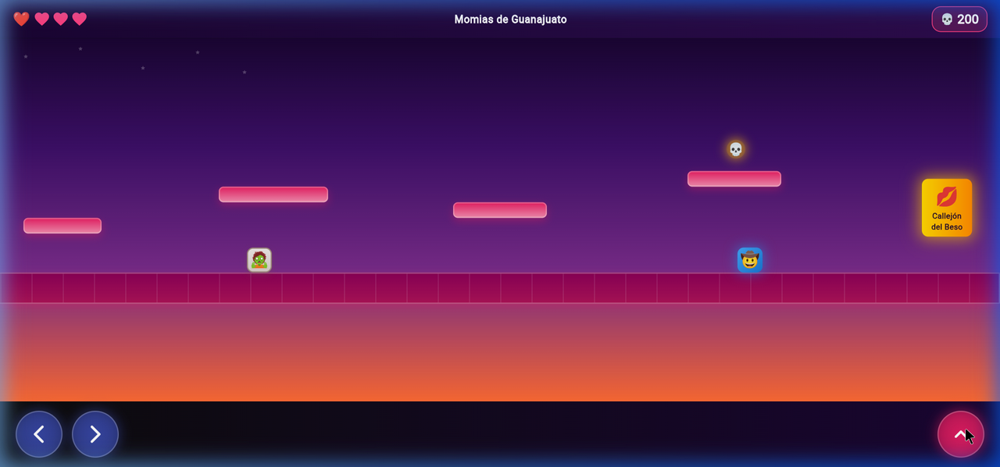

---

## 📋 Checklist de este proyecto TDD

| Estado | Verificación | Evidencias Asociadas |
| :---: | :--- | :--- |
| **[x]** | **1. La colisión AABB (Rectangulo) se probó de forma aislada antes de usarse en cualquier otra parte** | Código y Test AABB ([`evidencias/1.png`](evidencias/1.png)) |
| **[x]** | **2. `resolverColisionConPiso` usa la posición anterior del personaje, no solo la actual** | Lógica de costura ([`evidencias/2.png`](evidencias/2.png)) y Tests de piso ([`evidencias/2.1.png`](evidencias/2.1.png)) |
| **[x]** | **3. El criterio de 'stomp' exige caer Y estar en la mitad superior de la momia, no solo intersectar** | Lógica de combate ([`evidencias/3.png`](evidencias/3.png)) y Tests Stomp/Golpe ([`evidencias/3.1.png`](evidencias/3.1.png)) |
| **[x]** | **4. `patrullar()`, aleatoriedad y lógica sensible al tiempo son deterministas en las pruebas** | Lógica patrullaje ([`evidencias/4.png`](evidencias/4.png)) y Tests deterministas ([`evidencias/4.1.png`](evidencias/4.1.png)) |
| **[x]** | **5. `MotorJuego.mover()` es el único lugar que decide el orden de física, combate, recolección y meta** | Orquestador `mover()` ([`evidencias/5.png`](evidencias/5.png)) y Tests de integración ([`evidencias/5.1.png`](evidencias/5.1.png)) |
| **[x]** | **6. La interfaz no decide colisiones ni puntajes — solo traduce el estado de `MotorJuego` a píxeles** | Captura del juego activo ([`evidencias/06_juego_en_ejecucion.png`](evidencias/06_juego_en_ejecucion.png)) |
| **[x]** | **7. Suite completa de pruebas automatizadas (23/23 tests en verde)** | Terminal Flutter Test ([`evidencias/7.png`](evidencias/7.png)) |

---

## 📸 Evidencias Detalladas del Proyecto

### 1. Colisión AABB Aislada (`Rectangulo`)
> **Requisito:** La colisión AABB (`Rectangulo`) se probó de forma aislada antes de usarse en cualquier otra parte del juego.

Se programó la clase inmutable `Rectangulo` en Dart puro y se verificó con pruebas unitarias para intersecciones positivas y separación total antes de usarse en pisos, momias o calaveritas.

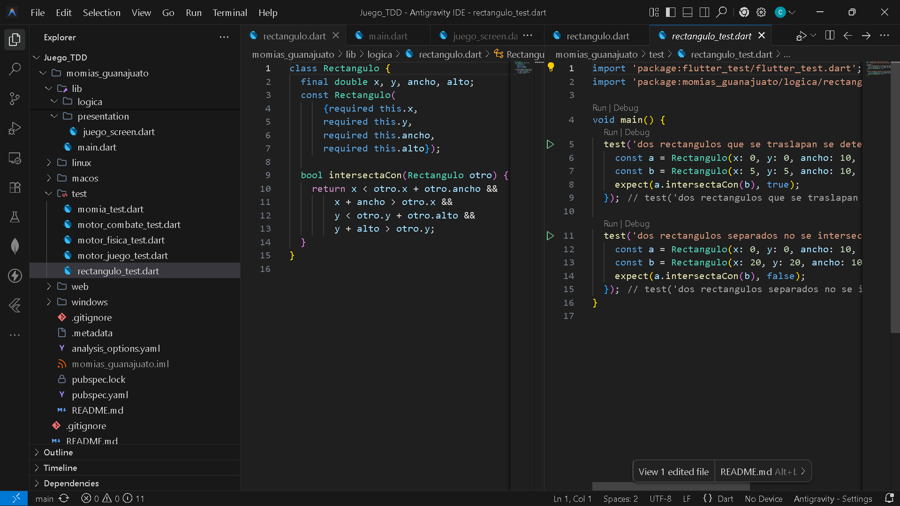

---

### 2. Aterrizaje sobre Plataformas con Costura Temporal (`yAnterior`)
> **Requisito:** `resolverColisionConPiso` usa la posición anterior del personaje (`yAnterior`), no solo la actual, distinguiendo caídas desde arriba de atravesamientos.

#### Implementación en `motor_fisica.dart`:
El método recibe `yAnterior` como parámetro-costura para validar que el personaje venía desde arriba (`yAnterior <= plataforma.y` y `pieActual >= plataforma.y`).
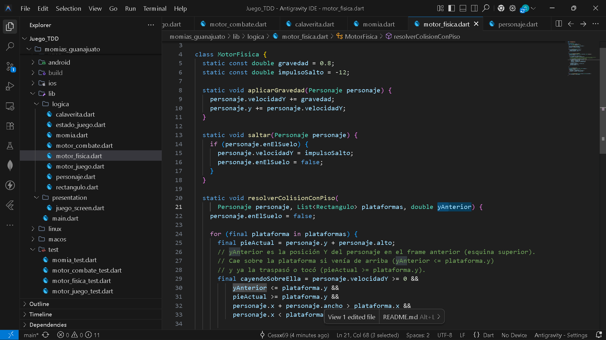

#### Pruebas Unitarias en `motor_fisica_test.dart`:
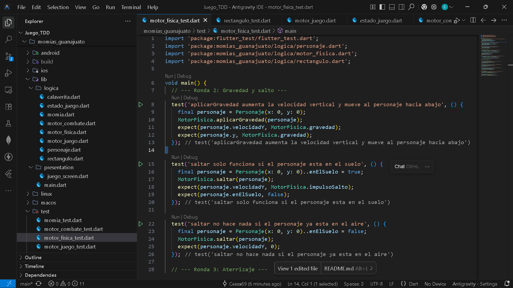

---

### 3. Combate: Stomp vs Impacto Lateral
> **Requisito:** El criterio de 'stomp' exige caer (`velocidadY > 0`) **Y** que el pie del personaje esté en la mitad superior de la momia (`pie <= momia.y + momia.alto / 2`), no solo intersectar.

#### Implementación en `motor_combate.dart`:
Se evalúa la velocidad descendente y la posición vertical para otorgar victoria con rebote (`momiaDerrotada`), o aplicar daño al jugador si el impacto fue lateral.
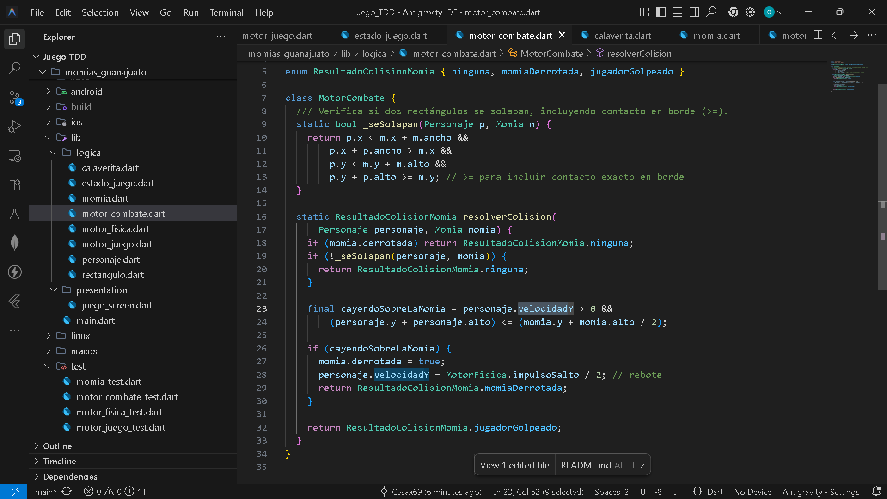

#### Pruebas Unitarias en `motor_combate_test.dart`:
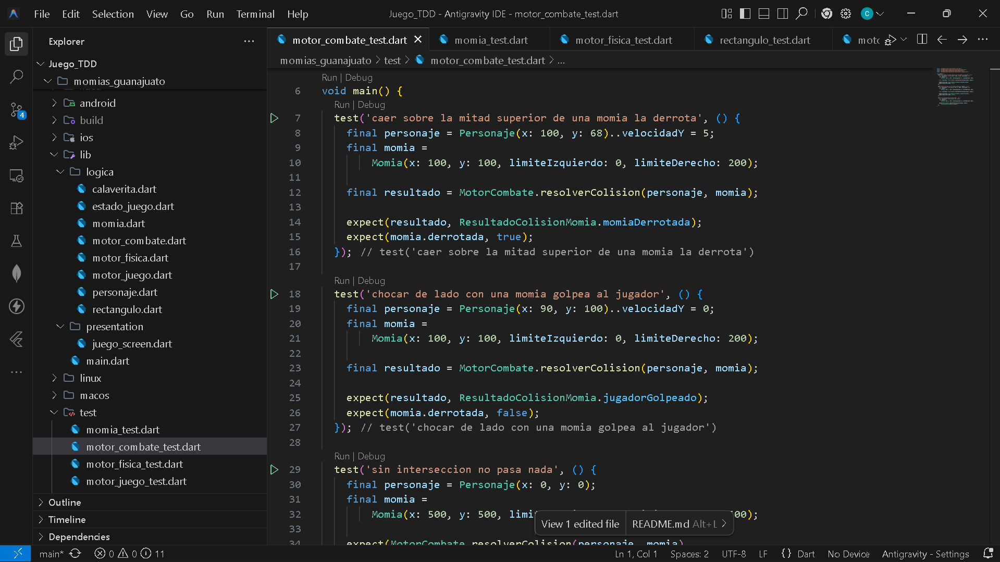

---

### 4. Patrullaje Determinista de la Momia
> **Requisito:** `patrullar()`, aleatoriedad y lógica sensible al tiempo son deterministas en las pruebas (sin dependencias de temporizadores asíncronos ni factores aleatorios incontrolables).

#### Implementación en `momia.dart`:
La inteligencia artificial avanza de forma determinista invirtiendo el signo de la velocidad al alcanzar los límites configurados.
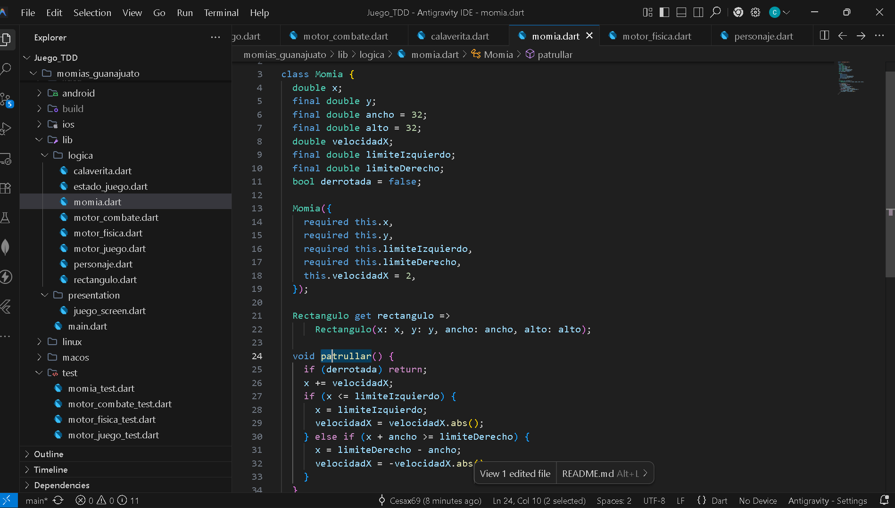

#### Pruebas Unitarias en `momia_test.dart`:
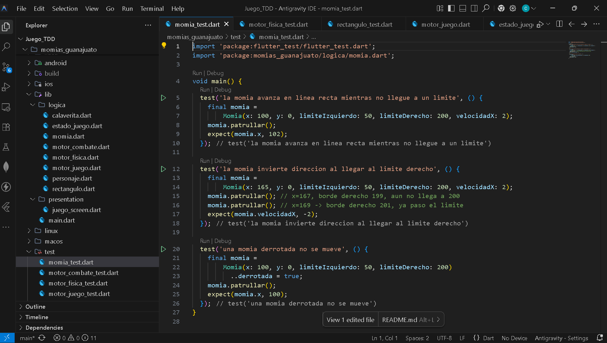

---

### 5. Bucle Orquestador `MotorJuego.mover()`
> **Requisito:** `MotorJuego.mover()` es el único lugar que decide el orden secuencial de física, combate, recolección y meta.

#### Implementación en `motor_juego.dart`:
Orquesta en un único punto el orden estricto de las reglas: desplazamiento horizontal, gravedad, colisión con plataformas, combate con momias, recolección de calaveritas y condición de victoria en la meta.
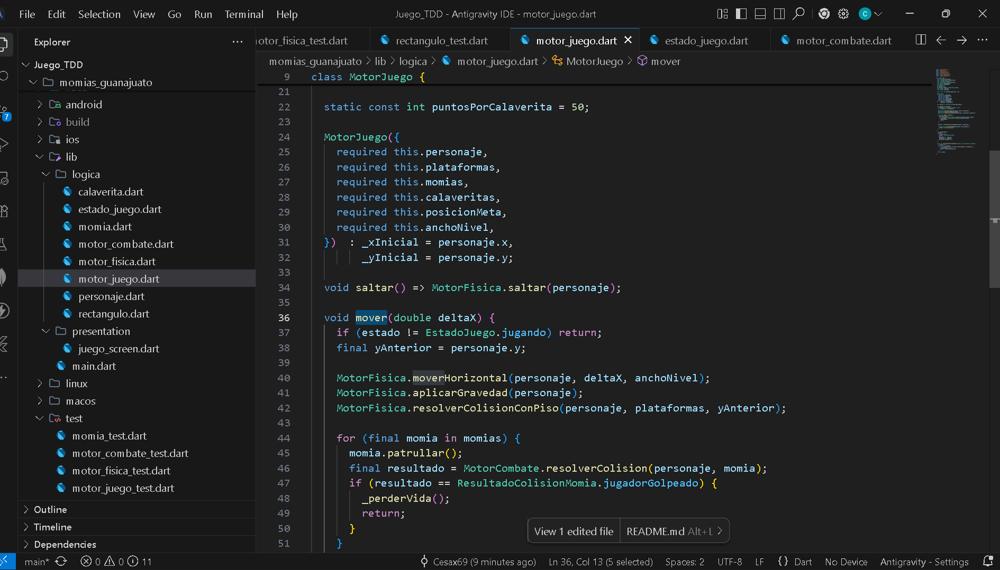

#### Pruebas Unitarias en `motor_juego_test.dart`:
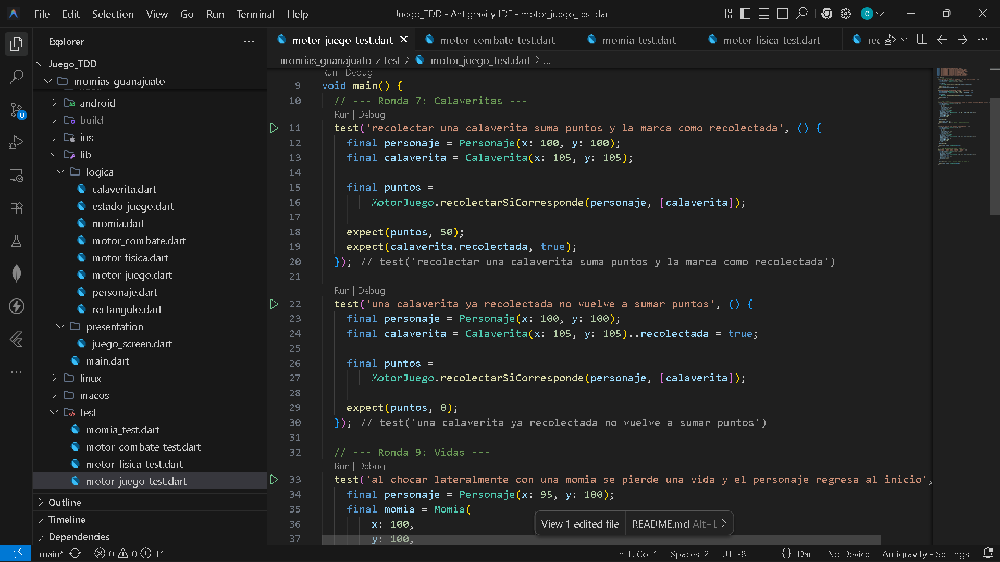

---

### 6. Interfaz Gráfica Desacoplada (Juego en Ejecución)
> **Requisito:** La interfaz no decide colisiones ni puntajes — solo traduce el estado de `MotorJuego` a píxeles.

Renderizado fluido con cámara que sigue al explorador, plataformas de cantera rosa guanajuatense, momias patrullando 🧟, calaveritas de azúcar 💀, HUD de corazones y el Callejón del Beso 💋 como meta.


---

### 7. Ejecución Total de la Suite de Pruebas (23/23 en Verde)
> **Requisito:** Todos los tests de los 5 archivos de prueba pasando al 100%.

```bash
flutter test --reporter=expanded
# 00:01 +23: All tests passed!
```

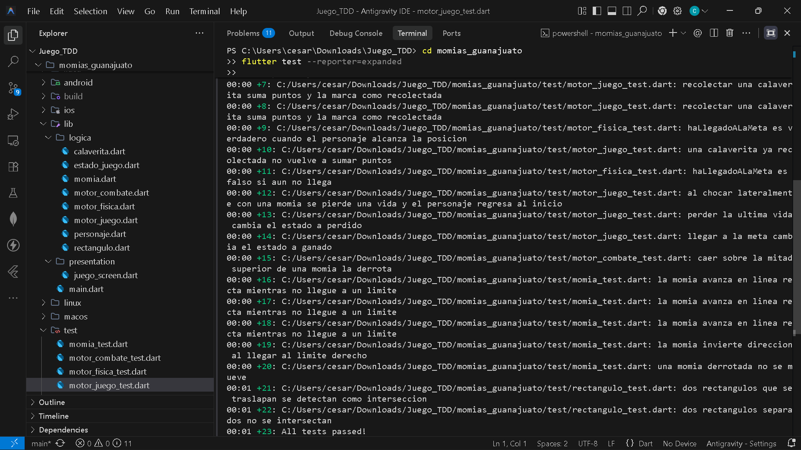

---

## 🏛️ Estructura del Proyecto

```
momias_guanajuato/
├── lib/
│   ├── logica/               # Capa Dart puro (sin Flutter)
│   │   ├── rectangulo.dart   # Bounding box AABB
│   │   ├── personaje.dart    # Estado del explorador
│   │   ├── momia.dart        # IA patrullaje determinista
│   │   ├── calaverita.dart   # Coleccionable de azúcar
│   │   ├── motor_fisica.dart # Gravedad, salto, piso y límites
│   │   ├── motor_combate.dart# Stomp vs daño lateral
│   │   ├── estado_juego.dart # jugando / ganado / perdido
│   │   └── motor_juego.dart  # Orquestador del bucle principal
│   ├── presentation/
│   │   └── juego_screen.dart # Cámara, sprites, HUD y controles táctiles/teclado
│   └── main.dart
└── test/
    ├── rectangulo_test.dart
    ├── motor_fisica_test.dart
    ├── momia_test.dart
    ├── motor_combate_test.dart
    └── motor_juego_test.dart
```

---

## 🚀 Cómo Ejecutar

### 1. Ejecutar las Pruebas Unitarias
```bash
cd momias_guanajuato
flutter test --reporter=expanded
```

### 2. Ejecutar la Aplicación en Web (Chrome / Edge)
```bash
cd momias_guanajuato
flutter run -d chrome
```

### 3. Controles
- **En pantalla:** Botones táctiles virtuales (Izquierda, Derecha y Salto).
- **En teclado (Web / Desktop):**
  - **Moverse a la izquierda:** `A` o `← Flecha izquierda`
  - **Moverse a la derecha:** `D` o `→ Flecha derecha`
  - **Saltar:** `Barra espaciadora`, `W` o `↑ Flecha arriba`
